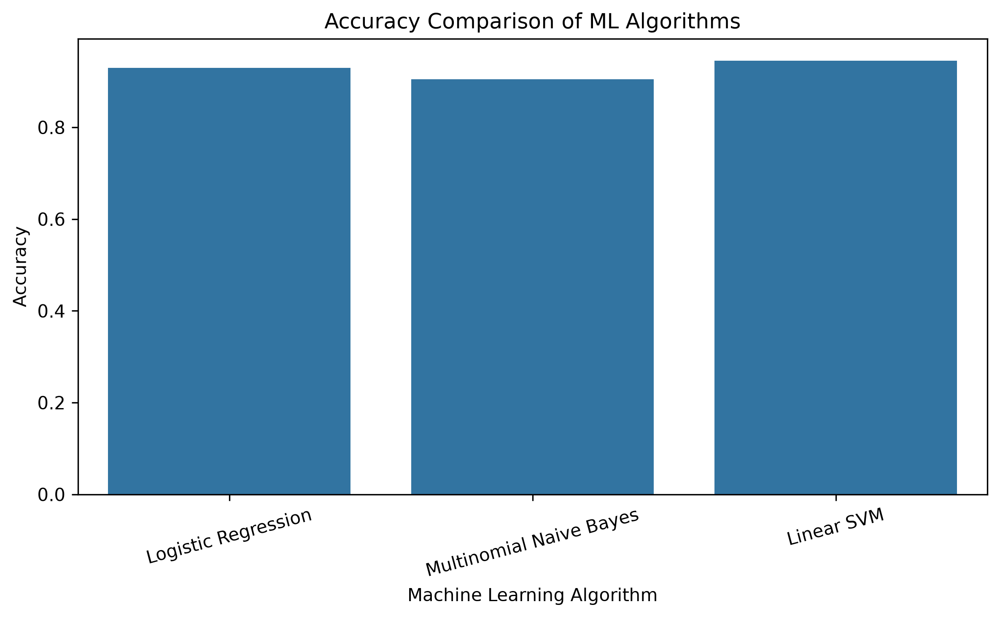
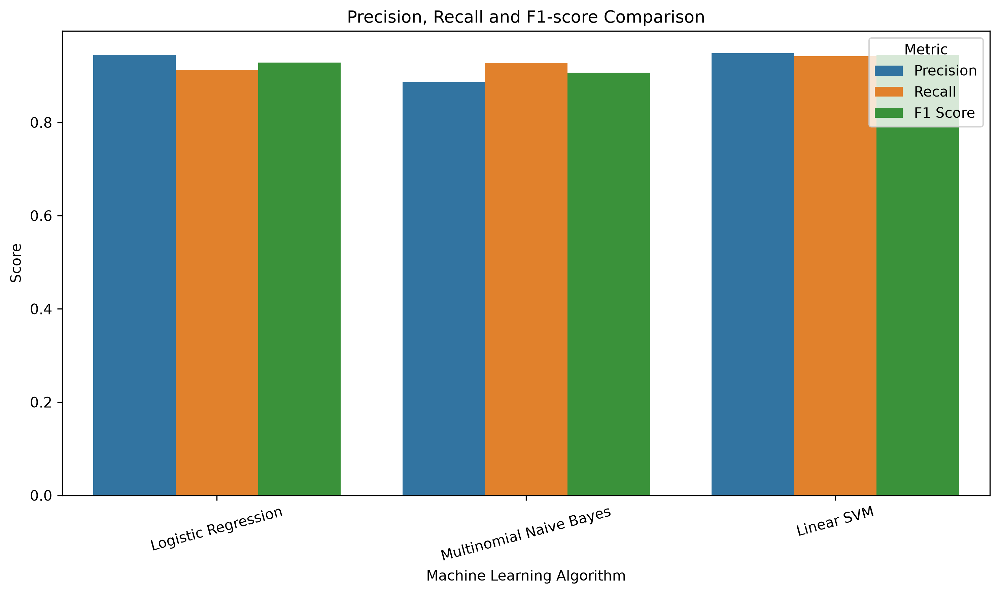

# 🌳 ReviewTrellis
### Fake Product Review Detection & Product Trust Analysis

**Detect suspicious product reviews using Machine Learning and help users make more informed purchasing decisions.**

---

## 📌 Project Overview

ReviewTrellis is a Machine Learning-based web application designed to identify potentially fake product reviews. Online shopping platforms contain a large number of customer reviews, but some reviews may be misleading, artificially generated, or written to manipulate product ratings.

ReviewTrellis analyzes the text of a review and predicts whether it is **Likely Genuine** or **Potentially Fake** using Natural Language Processing (NLP) and Machine Learning algorithms.

The project also provides a user-friendly website where users can enter a review and analyze its authenticity.

---

## 🎯 Project Objectives

- Identify potentially fake product reviews.
- Apply Natural Language Processing techniques to review text.
- Extract important textual features using TF-IDF.
- Train and compare multiple Machine Learning algorithms.
- Evaluate model performance using suitable metrics.
- Provide an interactive web application for review analysis.
- Help users understand the reliability of online product reviews.

---

## 🔄 Machine Learning Workflow

The project follows a complete Machine Learning workflow:

1. **Dataset Collection** – Collect product review data with genuine and fake review labels.
2. **Data Preprocessing** – Clean the review text and prepare it for analysis.
3. **Exploratory Data Analysis (EDA)** – Analyze the dataset and understand review patterns.
4. **Feature Extraction** – Convert text into numerical features using TF-IDF.
5. **Model Training** – Train multiple Machine Learning algorithms.
6. **Model Evaluation** – Compare models using Accuracy, Precision, Recall, and F1 Score.
7. **Best Model Selection** – Select the best-performing model based on evaluation results.
8. **Web Application Integration** – Connect the trained model with the website.
9. **Review Prediction** – Allow users to submit a review and receive a prediction.
10. **Prediction Explanation** – Show review-specific TF-IDF feature contributions and detected writing-style cues alongside each result.

The current Linear SVM does not provide calibrated class probabilities, so the site reports **Prediction confidence unavailable** instead of presenting its decision score as a confidence percentage. Explanations identify signals in the text and do not establish whether a review is authentic.

---

## 📂 Dataset Information

The project uses a product review dataset containing review text and corresponding labels.

### Dataset Files

| File | Description |
|---|---|
| `data/raw/Fake_Reviews.csv` | Original dataset |
| `data/processed/reviews_cleaned.csv` | Cleaned and processed dataset |

### Dataset Labels

| Label | Meaning |
|---|---|
| OR (0) | Genuine review |
| CG (1) | Computer-generated or fake review |

The dataset is used to train and evaluate the Machine Learning models.

**Dataset Source:** Add the original dataset download link here.

**Dataset License:** Verify the dataset's license before sharing the dataset publicly.

---

## 🧹 Data Preprocessing

The review text is prepared before feature extraction and model training.

Preprocessing may include:

- Handling missing values
- Removing duplicate records
- Cleaning unnecessary text
- Converting text into a consistent format
- Preparing review labels
- Splitting data into training and testing sets

The processed dataset is saved for further analysis and model training.

---

## 🧠 Algorithms Used

ReviewTrellis compares three Machine Learning algorithms.

### 1. Logistic Regression

Logistic Regression is a supervised classification algorithm used to predict whether a review belongs to the genuine or fake category.

### 2. Multinomial Naive Bayes

Multinomial Naive Bayes is a probabilistic classification algorithm commonly used for text classification tasks.

### 3. Linear Support Vector Machine (Linear SVM)

Linear SVM is a supervised learning algorithm that identifies a decision boundary between different classes. It is effective for high-dimensional text data.

**Best Model:** Linear SVM was selected as the best-performing model based on the project's evaluation results.

---

## 🔤 TF-IDF Feature Extraction

ReviewTrellis uses **Term Frequency–Inverse Document Frequency (TF-IDF)** to convert review text into numerical features.

TF-IDF measures the importance of words in a review relative to the collection of reviews.

It helps the Machine Learning models identify useful textual patterns for classification.

The extracted TF-IDF features are used as input to the classification algorithms.

---

## 📊 Model Performance

The models are evaluated using the following performance metrics:

- **Accuracy:** Measures the overall proportion of correct predictions.
- **Precision:** Measures how many reviews predicted as fake are actually fake.
- **Recall:** Measures how many actual fake reviews are correctly identified.
- **F1 Score:** Combines Precision and Recall into a single metric.

### 📊 Performance Comparison

| Algorithm | Accuracy | Precision | Recall | F1 Score |
| --- | ---: | ---: | ---: | ---: |
| Logistic Regression | 92.98% | 94.51% | 91.25% | 92.85% |
| Multinomial Naive Bayes | 90.44% | 88.65% | 92.74% | 90.65% |
| Linear SVM | 94.55% | 94.86% | 94.20% | 94.53% |

🏆 **Best Performing Model: Linear SVM**

*Replace the remaining values with the exact results from `evaluation_summary.csv` or `model_comparison.csv` before publishing.*

---

## 📈 Graphs & Visualizations

The project includes visualizations to understand the dataset and compare model performance.

### Accuracy Comparison



This graph compares the accuracy of the Machine Learning algorithms.

### Precision, Recall and F1 Score Comparison



This graph compares the Precision, Recall, and F1 Score of the trained models.

### Exploratory Data Analysis

EDA visualizations are available in the `reports/eda/` directory.

These graphs help understand the dataset, review distribution, and patterns in the review text.

---

## ⚙️ Installation & Run Instructions

### Step 1: Clone the Repository

```bash
git clone YOUR_GITHUB_REPOSITORY_URL
```

### Step 2: Open the Project Folder

```bash
cd ReviewTrellis
```

### Step 3: Create a Virtual Environment

```bash
python -m venv venv
```

### Step 4: Activate the Virtual Environment

**Windows:**

```bash
venv\Scripts\activate
```

**Linux / macOS:**

```bash
source venv/bin/activate
```

### Step 5: Install Required Libraries

```bash
pip install -r requirements.txt
```

### Step 6: Run the Web Application

```bash
python -m app.server
```

### Step 7: Open the Website

Open your browser and visit:

```text
http://127.0.0.1:5000
```

The website will be available locally while the backend server is running.

To stop the server, press `Ctrl + C` in the terminal.

---

## 🧪 Testing

The project includes tests for checking the web application.

Run the tests using:

```bash
python -m unittest discover -s tests
```

---

## 🛠️ Technologies Used

| Technology | Purpose |
|---|---|
| Python | Main programming language |
| Flask | Backend web framework |
| HTML | Website structure |
| CSS | Website styling |
| JavaScript | Frontend interaction |
| Pandas | Dataset handling |
| NumPy | Numerical operations |
| Scikit-learn | Machine Learning algorithms |
| TF-IDF | Text feature extraction |
| Pickle | Saving the trained model |
| Jupyter Notebook | Data analysis and experimentation |
| Git & GitHub | Version control and project hosting |

---

## ⚠️ Limitations

- The model's performance depends on the quality and diversity of the training dataset.
- Some genuine reviews may be classified as potentially fake.
- Some fake reviews may be classified as likely genuine.
- The model may not perform equally well on reviews from every product category.
- The system analyzes review text and may not verify the actual purchase or reviewer identity.
- Machine Learning predictions are estimates and should not be treated as absolute proof of review authenticity.

---

## 🚀 Future Scope

Possible improvements include:

- Adding more diverse product review datasets.
- Improving detection of AI-generated and manipulated reviews.
- Supporting multiple languages.
- Adding product-level trust analysis.
- Detecting suspicious reviewer behavior.
- Integrating deep learning and transformer-based NLP models.
- Deploying the application on a cloud platform.
- Improving the model using real-world user feedback.

---

## 👩‍💻 Project Author

**Shaba Khatoon**

B.Tech Computer Science and Engineering (AI & ML)  
Ghani Khan Choudhary Institute of Engineering and Technology (GKCIET)

---

## ⭐ Acknowledgement

This project was developed as part of a Machine Learning mini-project to explore Natural Language Processing, text classification, model evaluation, and web application development.

If you find this project useful, consider giving the repository a ⭐ on GitHub.